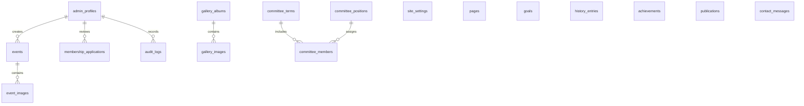

# NSTUANS Database Documentation

This document provides complete documentation of the PostgreSQL database schema for the **Noakhali Science and Technology University Anti-Narcotics Society (NSTUANS)** website.

---

## 1. Schema Overview

The database comprises **17 core tables** built with relational integrity, UUID primary keys, foreign key constraints with cascade behaviors, automated timestamp tracking, and indexes optimized for public reads and administrative queries.



---

## 2. Table Specifications

### 2.1 `admin_profiles`
- **Purpose:** Manages authorized administrators and enforces Role-Based Access Control (RBAC).
- **Columns:**
  - `id` (UUID, PK): References Supabase `auth.users(id)` ON DELETE CASCADE.
  - `email` (TEXT, UNIQUE, NOT NULL): Administrator email.
  - `full_name` (TEXT, NOT NULL): Name of admin.
  - `role` (TEXT, NOT NULL): Allowed: `'super_admin'`, `'content_admin'`.
  - `is_active` (BOOLEAN, NOT NULL): Account status (default `TRUE`).
  - `created_at`, `updated_at` (TIMESTAMPTZ).

### 2.2 `site_settings`
- **Purpose:** Centralized editable organization settings (motto, contacts, links).
- **Columns:**
  - `id` (UUID, PK): Auto-generated `gen_random_uuid()`.
  - `site_name` (TEXT): Official name.
  - `site_short_name` (TEXT): 'NSTUANS'.
  - `motto` (TEXT): "Say No to Drugs, Say Yes to Life."
  - `logo_url` (TEXT): Path or URL to official crest.
  - `contact_email`, `contact_phone` (TEXT): Official channels.
  - `office_address` (TEXT): University campus address.
  - `facebook_url`, `linkedin_url`, `youtube_url` (TEXT).

### 2.3 `pages`
- **Purpose:** Editable copy for static public routes (`about`, `mission`, `vision`, etc.).
- **Columns:**
  - `id` (UUID, PK).
  - `slug` (TEXT, UNIQUE, NOT NULL): Route identifier (e.g. `'about'`).
  - `title` (TEXT, NOT NULL).
  - `subtitle` (TEXT).
  - `content` (TEXT, NOT NULL): Full body text / HTML.
  - `meta_description` (TEXT): SEO summary.
  - `status` (TEXT, NOT NULL): `'draft'`, `'published'`, or `'archived'`.

### 2.4 `goals`
- **Purpose:** Stores the 7 Organizational and 7 Research Goals.
- **Columns:**
  - `id` (UUID, PK).
  - `goal_type` (TEXT, NOT NULL): Allowed: `'organizational'`, `'research'`.
  - `goal_number` (INT, NOT NULL): 1 to 7.
  - `title` (TEXT, NOT NULL): Heading of the goal.
  - `description` (TEXT, NOT NULL): Detailed explanatory text.
  - `display_order` (INT): Sorting sequence.
  - `is_active` (BOOLEAN).
  - **Constraint:** `unique_goal_type_number` (`goal_type`, `goal_number`).

### 2.5 `history_entries`
- **Purpose:** Chronological milestone entries for the society's journey.
- **Columns:**
  - `id` (UUID, PK).
  - `milestone_order` (INT).
  - `title` (TEXT, NOT NULL).
  - `date_or_year` (TEXT, NOT NULL): Exact date or year string.
  - `description` (TEXT, NOT NULL).
  - `is_verified` (BOOLEAN): Strict archival flag.
  - `status` (TEXT): `'draft'`, `'published'`, `'archived'`.

### 2.6 `events`
- **Purpose:** Campus rallies, educational seminars, and research exhibitions.
- **Columns:**
  - `id` (UUID, PK).
  - `title` (TEXT, NOT NULL).
  - `slug` (TEXT, UNIQUE, NOT NULL): URL slug for details page.
  - `short_description` (TEXT, NOT NULL): Card teaser.
  - `description` (TEXT, NOT NULL): Full rich agenda & details.
  - `cover_image` (TEXT): Storage URL or path.
  - `location` (TEXT, NOT NULL): Venue name.
  - `start_datetime` (TIMESTAMPTZ, NOT NULL).
  - `end_datetime` (TIMESTAMPTZ).
  - `status` (TEXT): `'draft'`, `'published'`, `'archived'`.
  - `created_by` (UUID): References `admin_profiles(id)`.
  - `published_at` (TIMESTAMPTZ).

### 2.7 `event_images`
- **Purpose:** Multi-image gallery attachments for specific events.
- **Columns:**
  - `id` (UUID, PK).
  - `event_id` (UUID, NOT NULL): References `events(id)` ON DELETE CASCADE.
  - `image_url` (TEXT, NOT NULL).
  - `caption` (TEXT).
  - `display_order` (INT).

### 2.8 `committee_terms`
- **Purpose:** Society terms (e.g. 2025–2026).
- **Columns:**
  - `id` (UUID, PK).
  - `term_name` (TEXT, UNIQUE, NOT NULL).
  - `start_year`, `end_year` (INT).
  - `is_current` (BOOLEAN).

### 2.9 `committee_positions`
- **Purpose:** Configurable leadership designations and hierarchic ranks.
- **Columns:**
  - `id` (UUID, PK).
  - `title` (TEXT, UNIQUE, NOT NULL): e.g. 'President', 'Chief Patron'.
  - `category` (TEXT, NOT NULL): `'advisory'`, `'executive'`, `'general'`.
  - `rank_order` (INT).

### 2.10 `committee_members`
- **Purpose:** Advisors and student committee officers.
- **Columns:**
  - `id` (UUID, PK).
  - `committee_term_id` (UUID, NOT NULL): References `committee_terms(id)`.
  - `position_id` (UUID): References `committee_positions(id)`.
  - `full_name` (TEXT, NOT NULL).
  - `department` (TEXT, NOT NULL).
  - `session` (TEXT).
  - `student_id` (TEXT): **Private** field.
  - `profile_image` (TEXT).
  - `biography` (TEXT).
  - `email` (TEXT): **Private** field.
  - `display_order` (INT).
  - `is_active` (BOOLEAN).
  - `is_verified` (BOOLEAN).

### 2.11 `gallery_albums`
- **Purpose:** Thematic photo albums.
- **Columns:**
  - `id` (UUID, PK).
  - `title` (TEXT, NOT NULL).
  - `slug` (TEXT, UNIQUE, NOT NULL).
  - `description` (TEXT).
  - `cover_image` (TEXT, NOT NULL).
  - `event_date` (DATE).
  - `status` (TEXT): `'draft'`, `'published'`, `'archived'`.

### 2.12 `gallery_images`
- **Purpose:** Individual photos within albums.
- **Columns:**
  - `id` (UUID, PK).
  - `album_id` (UUID, NOT NULL): References `gallery_albums(id)` ON DELETE CASCADE.
  - `image_url` (TEXT, NOT NULL).
  - `caption` (TEXT).
  - `display_order` (INT).

### 2.13 `achievements`
- **Purpose:** Official accolades, awards, and historical honors.
- **Columns:**
  - `id` (UUID, PK).
  - `title` (TEXT, NOT NULL).
  - `description` (TEXT, NOT NULL).
  - `achievement_date` (DATE).
  - `image_url` (TEXT).
  - `is_verified` (BOOLEAN).
  - `status` (TEXT).

### 2.14 `publications`
- **Purpose:** Research papers, surveys, and drug prevention whitepapers.
- **Columns:**
  - `id` (UUID, PK).
  - `title`, `slug` (UNIQUE), `abstract`, `authors`, `file_url`, `publication_date`, `status`.

### 2.15 `contact_messages`
- **Purpose:** Contact inquiries received through the public form.
- **Columns:**
  - `id` (UUID, PK).
  - `full_name`, `email`, `subject`, `message`.
  - `is_read` (BOOLEAN, default `FALSE`).
  - `is_archived` (BOOLEAN, default `FALSE`).
  - `created_at` (TIMESTAMPTZ).

### 2.16 `membership_applications`
- **Purpose:** Student membership applications from `/join-us/`.
- **Columns:**
  - `id` (UUID, PK).
  - `full_name`, `student_id`, `department`, `session`, `email`, `phone`, `motivation`.
  - `status` (TEXT, default `'pending'`): Allowed: `'pending'`, `'approved'`, `'rejected'`.
  - `admin_notes` (TEXT): Internal review notes.
  - `reviewed_by` (UUID): References `admin_profiles(id)`.
  - `reviewed_at` (TIMESTAMPTZ).
  - `created_at` (TIMESTAMPTZ).

### 2.17 `audit_logs`
- **Purpose:** Complete security history of administrative actions.
- **Columns:**
  - `id` (UUID, PK).
  - `user_id` (UUID): References `admin_profiles(id)`.
  - `action` (TEXT, NOT NULL): e.g. `'CREATE_EVENT'`, `'APPROVE_APPLICATION'`.
  - `table_name` (TEXT, NOT NULL).
  - `record_id` (UUID).
  - `details` (JSONB): Action payload / diff.
  - `ip_address` (TEXT).
  - `created_at` (TIMESTAMPTZ).

---

## 3. Database Indexes

- **Slugs:** `idx_pages_slug`, `idx_events_slug`, `idx_gallery_albums_slug`, `idx_publications_slug`.
- **Public Filtering:** `idx_events_status_datetime`, `idx_gallery_albums_status`, `idx_goals_type_order`, `idx_committee_members_term`.
- **Admin Processing:** `idx_membership_applications_status`, `idx_contact_messages_read`, `idx_audit_logs_created_at`.

---

## 4. Supabase Storage Buckets

| Bucket Name | Access | Allowed MIME Types | Max Size |
| :--- | :--- | :--- | :--- |
| `site-assets` | Public Read | JPEG, PNG, WebP, SVG | 5 MB |
| `event-images` | Public Read | JPEG, PNG, WebP | 10 MB |
| `leader-profiles` | Public Read | JPEG, PNG, WebP | 5 MB |
| `gallery-images` | Public Read | JPEG, PNG, WebP | 15 MB |
| `publications` | Public Read | PDF | 25 MB |

---

## 5. Migration Execution Instructions

### Using the Supabase Dashboard SQL Editor
1. Log in to your [Supabase Dashboard](https://supabase.com/dashboard).
2. Select your project and navigate to the **SQL Editor**.
3. Open [`supabase/migrations/20261105000001_initial_schema.sql`](file:///c:/Users/eftek/Desktop/NSTUANS/supabase/migrations/20261105000001_initial_schema.sql) and click **Run**.
4. Open [`supabase/migrations/20261105000002_storage_setup.sql`](file:///c:/Users/eftek/Desktop/NSTUANS/supabase/migrations/20261105000002_storage_setup.sql) and click **Run**.
5. Open [`supabase/seed.sql`](file:///c:/Users/eftek/Desktop/NSTUANS/supabase/seed.sql) and click **Run** to populate baseline verified data.

### Using the Supabase CLI
```bash
supabase link --project-ref your-project-ref
supabase db push
supabase db reset # (Optional: applies migrations and runs seed.sql automatically)
```
