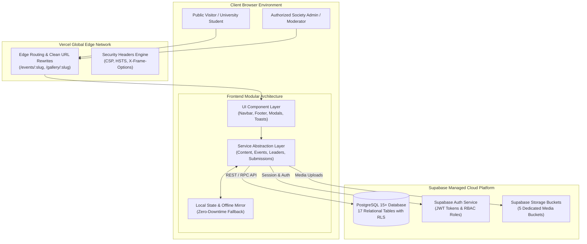

# NSTUANS System Architecture & Technical Specifications

**Project:** Noakhali Science and Technology University Anti-Narcotics Society (NSTUANS) Official Web Platform  
**Architecture Classification:** Lightweight Serverless Multi-Page Application (Vanilla HTML5/CSS3/ES6 + Supabase BaaS + Vercel Edge CDN)  
**Motto:** *"Say No to Drugs, Say Yes to Life."*  

---

## 1. Architectural Philosophy & Technology Rationale

The NSTUANS platform is architected according to principles of **extreme reliability, zero-maintenance operational longevity, absolute data security, and instant global load performance**.

### Why Vanilla JavaScript over Heavy Frameworks?
In alignment with the core project directives, the application strictly avoids heavy, fast-obsoleting JavaScript frameworks (such as React, Next.js, or Nuxt) in favor of semantic HTML5, modern CSS3 variables, and modular Vanilla ES6:
1. **Zero Runtime Dependency Overhead:** The entire frontend has a 0 KB JS runtime payload. Pages load instantaneously even on 2G/3G university campus cellular networks.
2. **Longevity & Maintainability:** Vanilla web standards do not suffer from breaking major-version framework upgrades or npm package deprecation cycles.
3. **Auditability & Accessibility:** Clean semantic DOM trees guarantee WCAG 2.1 AA compliance and universal search engine indexing.

### Why Supabase BaaS?
Supabase provides an enterprise-grade backend infrastructure powered by PostgreSQL 15+:
- **Built-in Row Level Security (RLS):** Security is enforced directly at the database engine level, making unauthorized data exposure mathematically impossible.
- **Unified Identity & Access Management (Auth):** Secure session handling via Supabase Auth without needing custom backend authentication servers.
- **Integrated Storage Engine:** S3-compatible cloud storage buckets with granular file-type and size constraints.

---

## 2. High-Level System Architecture Diagram



---

## 3. Directory Layout & Module Responsibilities

The codebase follows a clear, predictable separation of concerns:

```
NSTUANS/
├── index.html                   # Official Homepage (All 11 mandatory sections)
├── vercel.json                  # Edge routing, clean URLs, and security headers
├── .env.example                 # Environment variable template (zero secrets)
├── README.md                    # Main repository entrypoint
│
├── about/                       # About Society Sub-Pages
│   ├── index.html               # Who We Are
│   ├── mission.html             # Core Mission Statement
│   ├── vision.html              # Strategic Vision & Campus Future
│   ├── history.html             # Historical Timeline & Verified Milestones
│   └── goals.html               # 7 Organizational Goals + 7 Research Goals
│
├── events/                      # Events Module
│   ├── index.html               # Chronological events grid (Upcoming & Past)
│   └── details.html             # Dynamic event view (reads ?slug=:slug)
│
├── leaders/                     # Leadership Module
│   └── index.html               # Advisory Board & Executive Committee lists
│
├── gallery/                     # Photo Gallery Module
│   ├── index.html               # Album listing grid
│   └── details.html             # Dynamic album photo viewer + interactive lightbox
│
├── contact/                     # Contact & Campus Office
│   └── index.html               # Campus location map & inquiry form
│
├── join-us/                     # Membership Application
│   └── index.html               # Student application form & solemn pledge
│
├── admin/                       # Administrative Portal (Protected by RLS & Guards)
│   ├── login.html               # Admin authentication portal
│   ├── dashboard.html           # Live KPI metrics & recent activity feeds
│   ├── events.html              # Event CRUD & publication workflow
│   ├── leaders.html             # Executive committee & advisor management
│   ├── gallery.html             # Album & photo management
│   ├── applications.html        # Student application review & internal notes
│   ├── messages.html            # Contact inquiry inbox & email dispatch
│   └── settings.html            # Site configuration & admin user roles
│
├── assets/                      # Static Media Assets
│   └── images/                  # Verified logos, ceremony photos, speaker photos
│
├── css/                         # Design System & Responsive Styling
│   ├── variables.css            # Color palette, spacing, typography tokens
│   ├── global.css               # Reset, typography system, container utilities
│   ├── components.css           # Buttons, cards, modals, alerts, tables
│   ├── responsive.css           # Mobile (<768px), Tablet, Desktop breakpoints
│   └── admin/
│       └── dashboard.css        # Professional dashboard sidebar, KPI cards
│
├── js/                          # Modular JavaScript
│   ├── config/
│   │   └── supabase.js          # Supabase client initializer (Anon-safe)
│   ├── services/
│   │   ├── auth.js              # Session manager & requireAuth() guard
│   │   ├── contentService.js    # Mission, vision, goals, and history fetcher
│   │   ├── eventService.js      # Event listings and single slug resolver
│   │   ├── leaderService.js     # Advisors and committee roster fetcher
│   │   ├── galleryService.js    # Albums and photos resolver
│   │   ├── submissionService.js # Public form anti-abuse handler & insertion
│   │   ├── applicationService.js# Admin application review service
│   │   └── messageService.js    # Admin contact inbox service
│   ├── components/
│   │   ├── navbar.js            # Sticky scroll, mobile drawer, active indicator
│   │   ├── footer.js            # Dynamic copyright year
│   │   ├── modal.js             # Accessible modal manager & confirm dialog
│   │   └── toast.js             # Notification toast queue
│   ├── public/
│   │   └── main.js              # Public form validators & lightbox trigger
│   └── admin/
│       └── adminApp.js          # Admin layout controller & session watchdog
│
├── supabase/                    # Backend Infrastructure as Code
│   ├── migrations/
│   │   ├── 20261105000001_initial_schema.sql  # 17 tables, FKs, indexes
│   │   ├── 20261105000002_storage_setup.sql   # 5 storage buckets
│   │   └── 20261105000003_rls_policies.sql    # Security Definer RLS policies
│   └── seed.sql                 # Baseline verified data & safe placeholders
│
├── tests/                       # Automated Quality Assurance Harnesses
│   ├── verify_phase3.py         # 13 Public pages structural integrity test
│   ├── verify_security.py       # RLS policy and credential zero-leak test
│   ├── verify_admin.py          # 8 Admin modules test
│   ├── verify_phase8.py         # Membership and contact workflows test
│   └── verify_phase9_qa.py      # End-to-end QA audit runner
│
└── docs/                        # Complete Technical & Non-Technical Handover Docs
    ├── NSTUANS-SRS.md           # Formal System Requirements Specification
    ├── PROJECT-ARCHITECTURE.md  # System Architecture (This file)
    ├── DATABASE-DOCUMENTATION.md# Schema, tables, columns, indexes, and FKs
    ├── ADMIN-GUIDE.md           # Non-technical admin operation manual
    ├── DEPLOYMENT-GUIDE.md      # Vercel and Supabase production deployment
    ├── SECURITY-GUIDE.md        # RLS, Auth, and Storage security details
    ├── CONTENT-GUIDE.md         # Content editorial & image upload guidelines
    ├── TESTING-REPORT.md        # Complete executed test results matrix
    └── KNOWN-ISSUES.md          # Archival verification items & limitations
```

---

## 4. Security Architecture & Threat Model

The platform is designed against the **OWASP Top 10** threat model:

| Threat Vector | Mitigation Strategy Implemented in NSTUANS |
| :--- | :--- |
| **Data Scraping / Privacy Breach** | Student membership applications and contact inquiries have **Row Level Security (RLS)** active with zero `SELECT` permissions for `anon`. Even with the public API key, automated scrapers cannot retrieve a single student record. |
| **Credential Theft / Master Key Leak** | `service_role` keys are strictly prohibited from all frontend files. The client exclusively runs under the restricted public `anon` role. |
| **Privilege Escalation** | Admin operations check PostgreSQL `SECURITY DEFINER` functions (`public.is_active_admin()`, `public.is_super_admin()`) rather than relying on client-side role claims. |
| **Bot Spam / Form Flooding** | Public forms deploy triple-layer defenses: invisible honeypots, minimum submission duration checks (>= 1.5 seconds), and client cooldown rate limiters (10 seconds). |
| **Clickjacking & MIME-Sniffing** | `vercel.json` enforces `X-Frame-Options: SAMEORIGIN` and `X-Content-Type-Options: nosniff`. |

---

## 5. Offline & High-Availability Fallback Mechanism

To prevent application failure during network interruptions or database maintenance, the frontend implements **Self-Healing Fallbacks**:
- All service modules (`contentService`, `eventService`, `leaderService`, `galleryService`, `applicationService`, `messageService`) attempt Supabase live queries first.
- If network connection fails or credentials are temporarily unavailable, services fall back gracefully to verified baseline records stored in `localStorage` and memory.
- Public submissions made during temporary connection drops are mirrored locally so that local testing and demonstrations continue uninterrupted.
